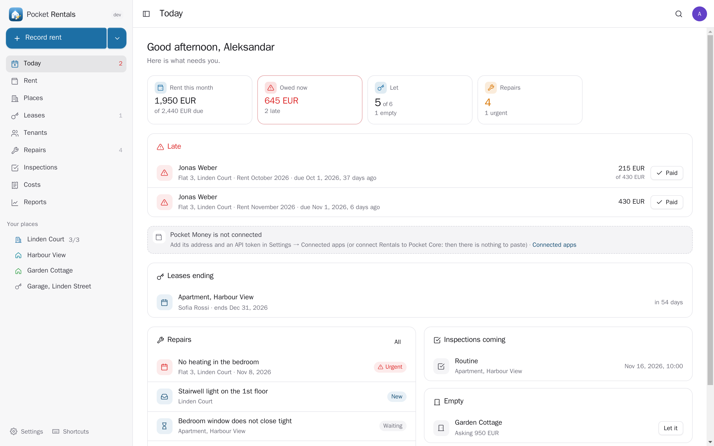
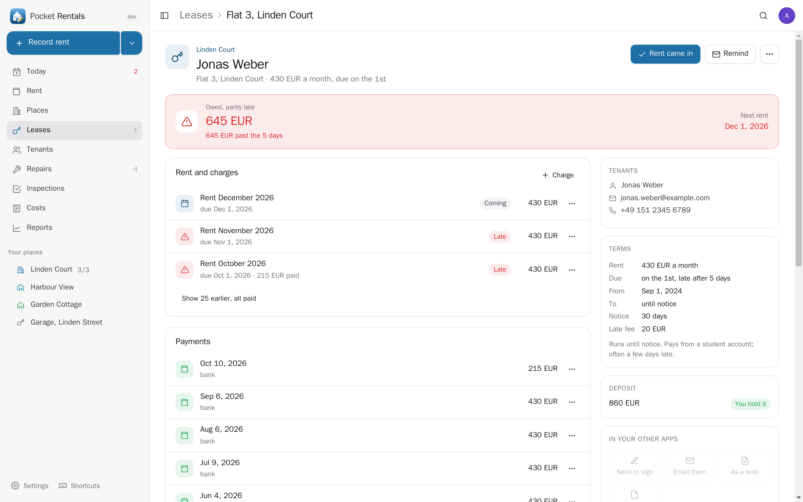
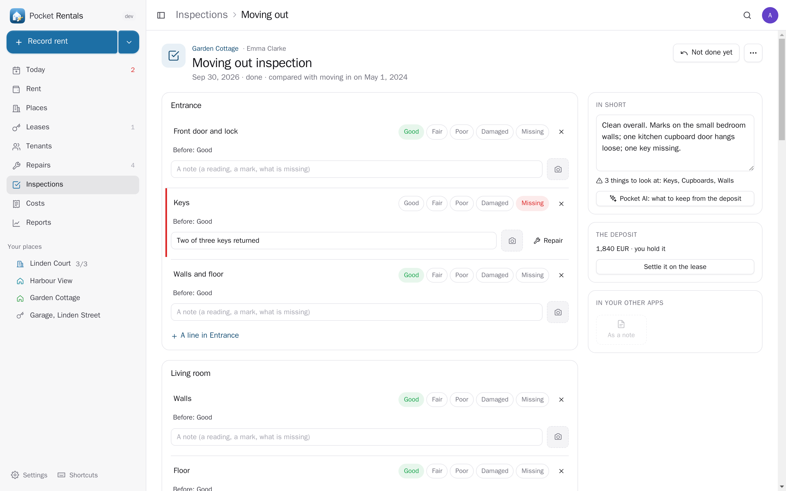
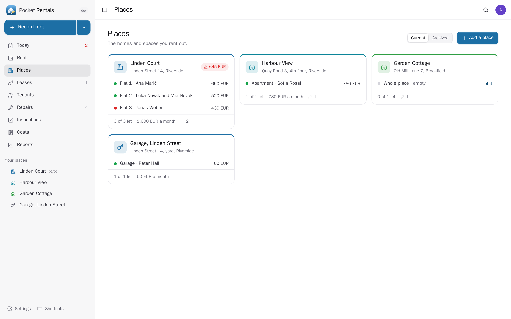
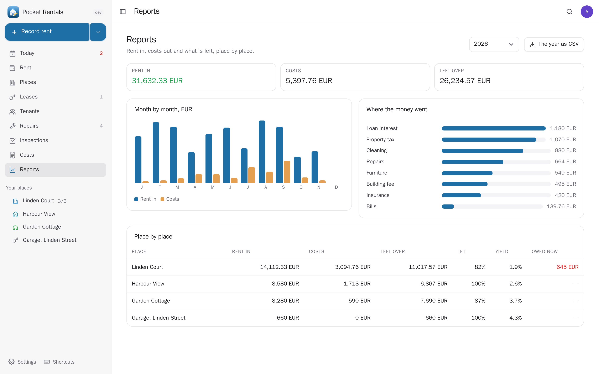
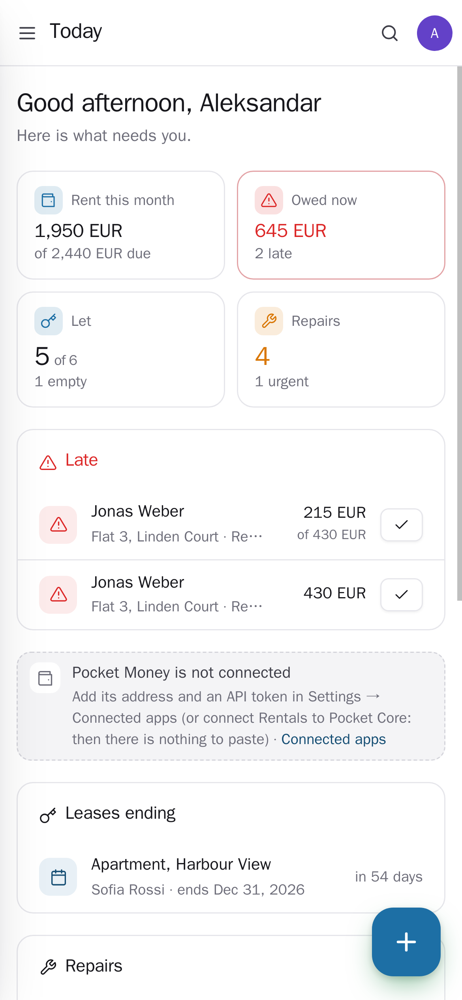
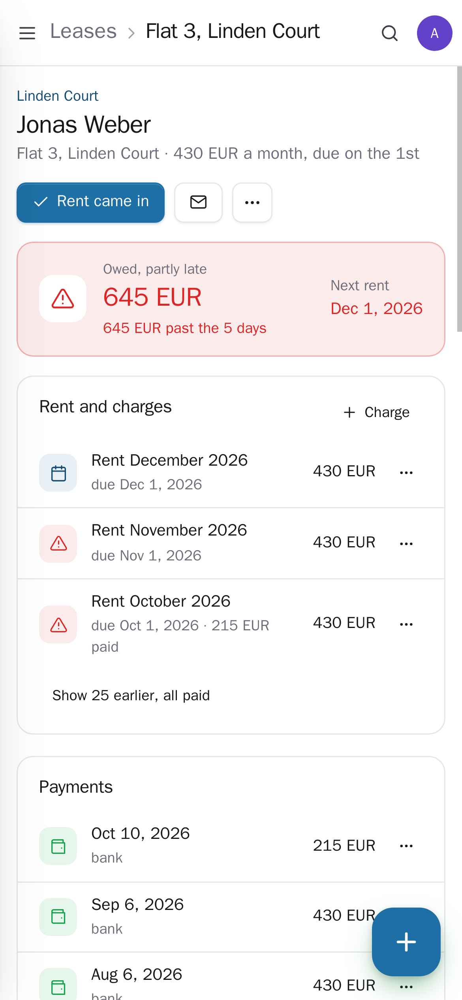

<p align="center"></p>
<h1 align="center">Pocket Rentals</h1>
<p align="center">The homes you rent out, in one place: places and units, tenants and leases, the rent due, paid and late, deposits, repairs and inspections with photos, and what each place earns and costs. Rent is counted every month by itself; Today says who is late, which lease ends soon and what needs fixing. Book rent in Pocket Money (or let it find the rent already in your bank), send leases to sign, pick tenants from your contacts — through your other Pocket apps when they are there, on its own when they are not. Bring your leases from a spreadsheet.<br>One Go binary, one SQLite file, one volume. Part of the Pocket apps; works on its own too.</p>
<p align="center">
  <a href="https://github.com/abjelosevic88/pocket-homelab-rentals/actions"></a>
  <a href="https://github.com/abjelosevic88/pocket-homelab-rentals/pkgs/container/pocket-homelab-rentals"></a>
  <a href="LICENSE"></a>
</p>

---

<p align="center"></p>

<table>
  <tr>
    <td width="50%"></td>
    <td width="50%"></td>
  </tr>
  <tr>
    <td align="center"><sub>A lease: what is owed and late, every rent and charge, payments, the tenants, the terms, the deposit and your other apps.</sub></td>
    <td align="center"><sub>Moving out, room by room, with how each thing looked when they moved in — for a fair deposit.</sub></td>
  </tr>
  <tr>
    <td width="50%"></td>
    <td width="50%"></td>
  </tr>
  <tr>
    <td align="center"><sub>Your places and who lives in each unit, for what rent.</sub></td>
    <td align="center"><sub>Reports: rent in and costs out by month, where the money went, place by place with occupancy and yield.</sub></td>
  </tr>
  <tr>
    <td width="50%"></td>
    <td width="50%"></td>
  </tr>
  <tr>
    <td align="center"><sub>On the phone: who is late, one tap when the rent came in.</sub></td>
    <td align="center"><sub>A lease on the phone.</sub></td>
  </tr>
</table>

## What it does

- **Places and units**: a house, a flat, a building with flats, a room, a garage — each unit with its asking rent and deposit, let or empty.
- **Leases** with one or more tenants: rent monthly, weekly, quarterly or yearly on a due day, a start and an end (or until notice), notice, a late fee, the deposit. A lease that starts or ends between two due days pays the part by the day.
- **Rent by itself**: each period's rent is made when it comes up, never twice. Payments pay the oldest charges first, so every rent shows paid, part paid, due, late or coming, and each lease what it owes. Bills, repairs and late fees are charges too; waive one instead of deleting it.
- **Today**: rent late and due soon, rent found in your bank, leases ending, urgent repairs, inspections coming, units standing empty.
- **Repairs**: who reported it, how urgent, who fixes it and when, the cost (it becomes a cost of the place), photos, and whether the tenant pays.
- **Inspections** room by room — moving in, moving out, routine — with a condition, a note and photos per line; moving out shows how each thing looked when they moved in.
- **Deposits**: held, given back in full or in part, with what was kept and why.
- **Costs and reports**: insurance, tax, fees, repairs per place; rent in and costs out by month, occupancy, yield, and the year as CSV for taxes.
- **Pocket AI** (optional, only when you press it): a rent reminder, a note about late rent or a lease ending, what to do first about a repair, a fair sum-up of a moving-out inspection.
- **Bring it in** from a spreadsheet of leases or of payments (CSV), or a Pocket Rentals export — twice is the same as once. Export everything as JSON or CSV.
- **Everyone their own** on one box: each person has their own places, leases, settings and connections; admins see no one else's rentals.
- **A morning note** through Apprise, ntfy or a webhook: rent due and late, leases ending, urgent repairs.

## Run it

```sh
docker run -d --name pocket-rentals -p 8080:8080 -v ./data:/data \
  -e BASE_URL=https://rentals.example.com -e SECURE_COOKIES=true \
  ghcr.io/abjelosevic88/pocket-homelab-rentals:latest
```

or `docker compose up -d` with [docker-compose.yml](docker-compose.yml). Open it, create the first account and add a place. All options: [docs/configuration.md](docs/configuration.md). API: [docs/api.md](docs/api.md). Backups: [docs/backup.md](docs/backup.md).

## With Pocket Core

Set `CORE_URL` and `CORE_REGISTRATION_KEY` and Rentals joins the box: people sign in with Pocket Core, Pocket AI helps, and through app links your rentals reach your own Pocket apps with nothing to paste:

| App | In Rentals | Without it | Scopes |
|---|---|---|---|
| Pocket Contacts | pick tenants from your contacts or add them there; open their card | the tenant's name, email and phone live here | `contacts:read`, `contacts:write` |
| Pocket Money | book rent in and costs out on your accounts; rent already in your bank is offered, one tap to record it | money is counted here only | `accounts:read`, `transactions:read`, `transactions:write` |
| Pocket Sign | send a lease from your templates to the tenants; when all signed, a draft lease starts | — | `signing:read`, `signing:write` |
| Pocket Calendar | inspections, repair visits and lease ends, kept in step | each one downloads as a calendar file | `calendar:write` |
| Pocket Tasks | a repair or a renewal as a task; ticked there = repair done here | repairs live here | `tasks:read`, `tasks:write` |
| Pocket Notes | an inspection report, a lease summary, a repair as a note | — | `notes:write` |
| Pocket Mail | reminders and notes from your own mailbox | the email opens in your own email app | `mail:send` |
| Pocket Invoicing | a draft invoice for a rent or a charge; when it is paid | — | `invoices:read`, `invoices:write` |
| Pocket Documents | attach the signed lease, IDs, insurance from your archive | upload a PDF here | `documents:read` |
| Pocket Home | pick the tradesperson for a repair; finished repairs in the place's log | type who fixes it | `home:read`, `home:write` |
| Pocket Forms | answers to your repair form become repairs, at the right lease | add repairs by hand | `forms:read` |
| Pocket AI | reminders, repair advice, inspection sum-ups; the Ask button on every page | your own OpenAI key, or no AI | inference |

**Nothing depends on another app.** Each app's state is checked per person — connected, switched off here, switched off in Pocket Core, not on this box, too old — and what needs it is shown greyed out with one line saying why and what to do, never hidden.

Other apps use your rentals through `rentals:read` and `rentals:write`: Pocket Contacts shows on a tenant's card where they rent and what they owe, Pocket Day writes rent in and repairs into your journal, Pocket Search finds places, leases and tenants, Pocket Renewals reminds you of lease ends, Pocket AI tells you what is due and reports repairs when you ask. Events on the bus — `rentals.rent_due`, `rentals.rent_late`, `rentals.payment_recorded`, `rentals.lease_started`, `rentals.lease_ending`, `rentals.lease_ended`, `rentals.request_created`, `rentals.request_done` — start flows in Pocket Flows. Without Core every connection can be made directly with a URL and a token; the Core-only choices stay visible, greyed out.

## Develop

```sh
make dev     # API on :8080 with demo data + Vite on :5173
make test    # go vet, go test, tsc
make         # web + binary
```

`node scripts/screenshots.mjs` takes the screenshots above from a demo instance and fails on any browser error. MIT licensed.
